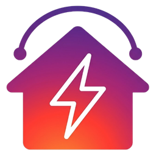

<div align="center">



# Contact Energy for Home Assistant

**Your Contact Energy electricity and gas usage and cost, in the Energy Dashboard.**

[](https://github.com/leashjay/ha-contact-energy/actions/workflows/ci.yml)
[](https://github.com/leashjay/ha-contact-energy/releases/latest)
[](https://hacs.xyz)
[](https://www.home-assistant.io)
[](LICENSE)

[](https://my.home-assistant.io/redirect/hacs_repository/?owner=leashjay&repository=ha-contact-energy&category=integration)
[](https://my.home-assistant.io/redirect/config_flow_start/?domain=contact_energy)

</div>

> [!IMPORTANT]
> **Unofficial.** This integration is not made, endorsed or supported by Contact Energy. It reads your usage from the same web service that the Contact Energy website uses, signing in with your own account, so Contact Energy could change it at any time and break this. Your email and password are stored in Home Assistant's own configuration storage, like any other integration, and are sent only to Contact Energy's servers. "Contact Energy" is a trademark of Contact Energy Limited; the icon here is our own and is not their logo.

**Contents:** [Features](#features) · [Install](#installation) · [Set up](#setup) · [Energy Dashboard](#energy-dashboard) · [How it works](#how-it-works) · [Upgrading](#upgrading-from-201-or-earlier) · [Troubleshooting](#troubleshooting) · [Contributing](#contributing)

---

## Features

- ⚡ **Hourly electricity** usage (kWh) and cost (NZD), including off-peak and free-power periods
- 🔥 **Monthly gas** usage, with an optional price per kWh for cost (dual-fuel accounts)
- 📈 Feeds the **Energy Dashboard** directly, with no template sensors or YAML
- ⏪ **Backfills history** in the background, up to a year
- 🔁 Keeps recent days up to date and signs in again by itself if the login expires

## Requirements

- Home Assistant **2026.5** or later
- A Contact Energy account (electricity; gas for dual-fuel accounts)

## Installation

### Via HACS (recommended)

1. Install [HACS](https://hacs.xyz/docs/use/download/download/) if you haven't already.
2. Click **Open in HACS** above, or go to **HACS → ⋮ → Custom repositories** and add `https://github.com/leashjay/ha-contact-energy` as an **Integration**.
3. Click **Download** on the **Contact Energy** card.
4. Restart Home Assistant.

### Manually

Copy the `custom_components/contact_energy/` folder into your Home Assistant config directory and restart:

```text
/config/custom_components/contact_energy/
```

## Setup

Click **Add integration** above, or go to **Settings → Devices & Services → Add Integration** and search for **Contact Energy**.

| Option | Default | Notes |
| --- | --- | --- |
| Email / Password | | Your Contact Energy login |
| Days of usage history to backfill | 90 | 1 to 365. Loaded in the background after setup, so it may take a while |
| Enable gas usage tracking | off | For dual-fuel accounts |
| Gas price per kWh | 0 | Optional. Contact's API reports no gas cost, so this is the only way to get one. `0` skips gas cost |

No `configuration.yaml` changes are needed. Everything can be changed later under **Settings → Devices & Services → Contact Energy → Configure**; raising the days of history backfills the extra in the background.

## Energy Dashboard

Go to **Settings → Dashboards → Energy → Configure** and add:

| Field | Value |
| --- | --- |
| Electricity consumed (grid) | **Electricity Usage**: total consumption, peak and off-peak |
| Cost | **Electricity Cost** (appears once data is available) |
| Gas consumed | **Gas Usage** (if gas tracking is on) |
| Gas cost | **Use a statistic** → **Gas Cost** (only if a gas price is set) |

> [!NOTE]
> **Data lags by about 2 days.** Today's and yesterday's usage won't appear yet. This comes from Contact Energy and is normal.

> [!WARNING]
> **Don't add "Special Rates" to the Energy Dashboard.** It's an informational subset showing how much of your usage was at a special, off-peak or free rate. It's already *included in* Electricity Usage and Cost, so adding it would double-count.

<details>
<summary><b>Off-peak and free power: how they're counted</b></summary>

If your plan has a genuinely free period, those hours add to **Electricity Usage** (kWh) but not to **Electricity Cost** (no charge). If your plan just has a cheaper off-peak *rate*, that cost is included in Electricity Cost like any other usage.

</details>

<details>
<summary><b>Gas cost is an estimate</b></summary>

Contact Energy never returns a gas dollar cost, so the integration works it out locally from the price you set in **Configure** (kWh × price). Changing the price recalculates your *whole* gas cost history at the new price. It isn't a record of what you actually paid if your price has changed over time.

</details>

## How it works

- Every **6 hours** the integration signs in to Contact Energy and re-reads the **last 7 days**, since the newest days are still being finalised.
- The numbers go into Home Assistant's **long-term statistics**, not into a sensor. That's why the **Contact Energy Usage** and **Gas Usage** entities are hidden and always read `0`: they only exist to trigger the update. To see your data, use the [Energy Dashboard](#energy-dashboard) or **Developer tools → Statistics**.
- Each refresh carries on from the totals already stored, so re-reading recent days never makes earlier history jump or go negative.

## Upgrading from 2.0.1 or earlier

<details>
<summary><b>What changed, and what to do</b></summary>

Older versions treated any hour with an off-peak or free rate as separate and **left it out of "Contact Energy"** (now **Electricity Usage**) and its cost, so totals were too low. Now every kWh counts. The statistic IDs are unchanged, so your Energy Dashboard keeps working, but only the days that get re-read are restated.

**To fix older history too:** open **Configure** and raise **Days of usage history to backfill** (up to 365). It's refetched in the background. Then compare a day with the Contact Energy website to check it matches.

Older versions also exposed a "Contact Energy Usage" sensor with a `total` state class, which produced meaningless zero statistics. After upgrading you may see a "no longer provided" fix under **Developer tools → Statistics**; it's safe to delete those entries.

</details>

## Troubleshooting

| Symptom | Cause / fix |
| --- | --- |
| The **Contact Energy Usage** entity shows `0` or is hidden | Expected. The data is in statistics, not in the entity. See [How it works](#how-it-works) |
| No data for today or yesterday | Contact Energy publishes about 2 days late |
| "Invalid email address or password" | Check you can sign in at myaccount.contact.co.nz |
| Gas shows no data | Gas tracking is off by default; turn it on in **Configure**. Gas is detected as the account's **second contract** (see below) |
| Older days look too low after upgrading | Raise **Days of usage history** in **Configure** to backfill them (see [Upgrading](#upgrading-from-201-or-earlier)) |

### Known limitations

- **Gas contract detection is a heuristic.** The API gives no field for a contract's fuel type, so a second contract alongside the electricity one is assumed to be gas. If yours is something else (for example a second meter), gas tracking may create a sensor with no data, or fail quietly. Please open an issue if you hit this.
- **One account only:** the first account on your login, and its first contract for electricity.
- **Gas is monthly.** The Energy Dashboard shows each month's gas as one spike at the start of the month, not spread over the days.

## Roadmap

- [ ] Solar / feed-in (exported energy) tracking
- [ ] Pricing / tariff sensors
- [ ] Multi-account support
- [ ] HACS default store submission

## Contributing

Issues and pull requests are welcome at [github.com/leashjay/ha-contact-energy](https://github.com/leashjay/ha-contact-energy/issues). See [CONTRIBUTING.md](CONTRIBUTING.md).

<details>
<summary><b>Development</b></summary>

The code targets Python 3.14, as Home Assistant does. Opening this repo in VS Code with the [Dev Containers extension](https://marketplace.visualstudio.com/items?itemName=ms-vscode-remote.remote-containers) sets up a full local HA instance automatically (dependencies are installed via `scripts/setup` on container creation). Then:

```bash
cp .env.example .env     # add your Contact Energy credentials
bash scripts/develop     # start Home Assistant at http://localhost:8123
bash scripts/lint        # run Ruff linter
python -m pytest tests/  # run unit tests
```

Without the dev container (plain local Python), create a virtual environment and install dependencies first:

```bash
python3 -m venv .venv && source .venv/bin/activate
bash scripts/setup       # pip install -r requirements.txt
cp .env.example .env     # add your Contact Energy credentials
bash scripts/develop     # start Home Assistant at http://localhost:8123
```

The tests stub out Home Assistant, so they can't prove an HA call is real: check any Home Assistant API you add against HA's own source.

#### Capturing real API responses

`scripts/capture_usage_fixtures.py` logs in with the account in `.env` and saves each day's raw usage response as JSON, to help write tests against real data or spot API changes:

```bash
python3 scripts/capture_usage_fixtures.py --days 30 --skip-existing
```

It only talks to Contact Energy's API and writes to `raw_data/usage/`, which is gitignored because it contains **your real usage data**. Never commit or share it; redact anything you copy into `tests/` as a fixture.

</details>

## Credits

A fork of [codyc1515/ha-contact-energy](https://github.com/codyc1515/ha-contact-energy). Gas tracking and the history backfill were contributed by [@njs50](https://github.com/njs50). Licensed under the [MIT License](LICENSE).
